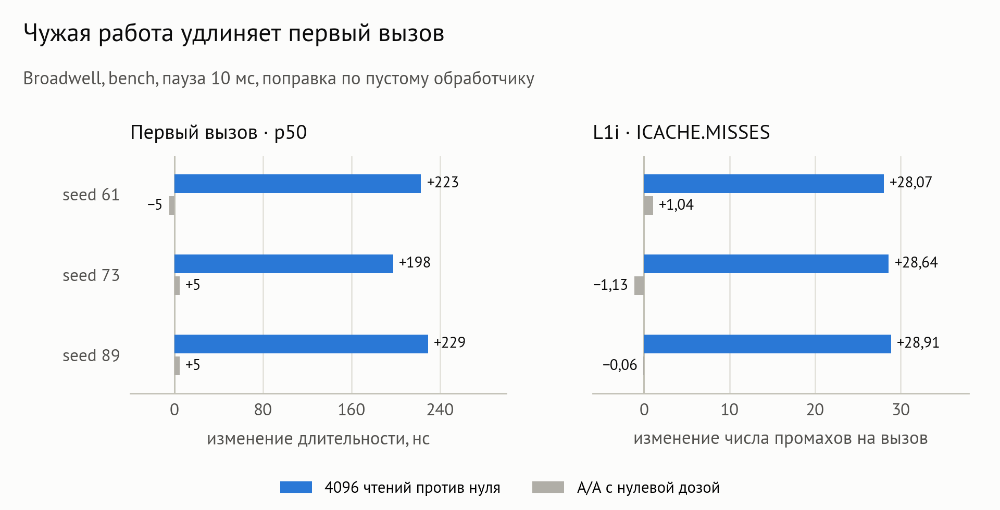
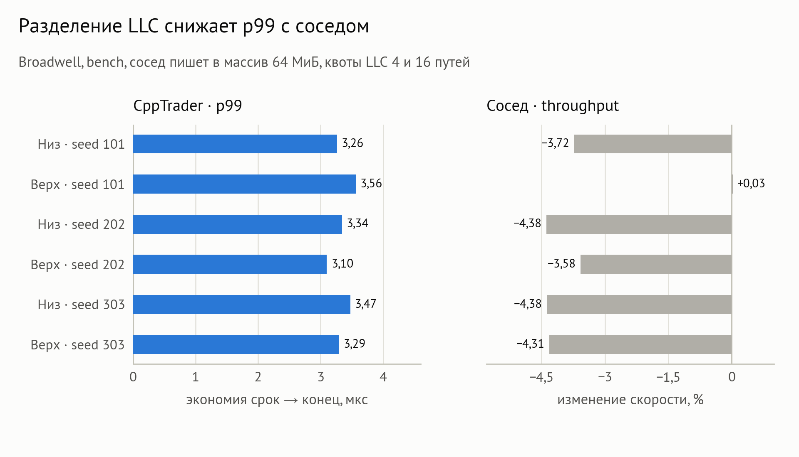

# Выделенное ядро как baseline и Intel CAT

**Коротко.** В лабораторных сериях на Xeon E5-2650L v4 события приходят по заданному расписанию. Baseline на выделенном ядре — обычный `spin`. Задержку в Bitstamp replay считаю от программной RX-метки. [Shadow execution](shadow.md) · [Prefetch](prefetch.md)

## 1. Busy-poll на выделенном ядре

**Что сделал.** Закрепил CppTrader на физическом ядре, отвёл системные службы и IRQ устройств на другие ядра и оставил только POLL. В первом контроле сравнил `hot` и первый вызов после 10 мс `spin`. В отдельном опыте добавил в ту же паузу восемь порций по 512 зависимых чтений из цепочки 1 МиБ. Прогнал три расписания с двумя нулевыми дозами (A/A) и пустым обработчиком. Время и PMU снимал отдельными запусками. [`bench`](../src/bench/main.cpp)

**Результат.** Холодный штраф первого вызова после поправки на пустой обработчик составил **354 нс** по медиане трёх пар запусков. На графике отдельный опыт с чтениями. После вычитания изменения у пустого обработчика медиана парной разности для 4096 и 0 чтений составила **+198…+229 нс**, а в A/A разность оставалась в пределах 5 нс. Среднее число событий `ICACHE.MISSES` выросло на **28–29 на вызов**. Знак эффекта по dTLB менялся.

## 2. Intel CAT при общем LLC

**Что сделал.** Запустил CppTrader в режиме `spin` и соседа с записью в массив 64 МиБ на двух физических ядрах одного LLC. Дал обработчику 4 пути и соседу 16. Через `resctrl` менял пересечение масок, сохраняя квоты и маску системной группы `0fff0`. Повторил опыт зеркально. Для каждой конфигурации масок прогнал три одинаковых расписания с обоими процессами вместе и с каждым по отдельности. [Сосед](../src/neighbour/main.cpp)

| Маска обработчика | Маска соседа с пересечением | Маска соседа без пересечения |
| --- | --- | --- |
| `0000f` | `0ffff` | `ffff0` |
| `f0000` | `ffff0` | `0ffff` |

**Результат.** На графике шесть сравнений при совместной работе. Разделение путей снизило p99 от срока события до конца обработки на **3,10–3,56 мкс**. Сосед замедлился в пяти сравнениях из шести, максимум на **4,4%**. В отдельном контроле без соседа разность того же p99 составила **−23…+38 нс**.

В отдельной серии сравнил `spin` с [shadow execution](shadow.md) и [prefetch](prefetch.md) для каждой квоты. При 20 общих путях shadow каждые 200 мкс снизил p99 на 1,81–2,15 мкс в шести запусках. После разделения LLC добавочный эффект обоих способов менял знак.

## 3. Контроль C-states

**Что сделал.** Для этого контроля разрешил все idle states. При паузе 10 мс сравнил обычный сон, пустые пробуждения раз в 1 мс и те же пробуждения с shadow execution. [Политика простоя](../cstate.sh)

**Результат.** p50 от срока события до конца составил **47,2 / 7,8 / 6,9 мкс**. Основное снижение медианы появилось уже при пустых пробуждениях. Shadow execution улучшил p99 относительно пустых пробуждений в одном повторе из трёх.
