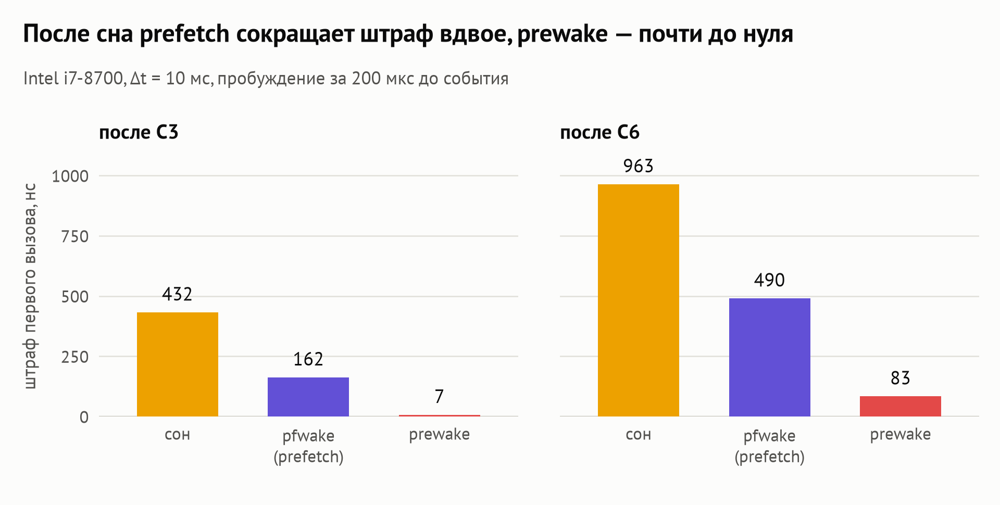
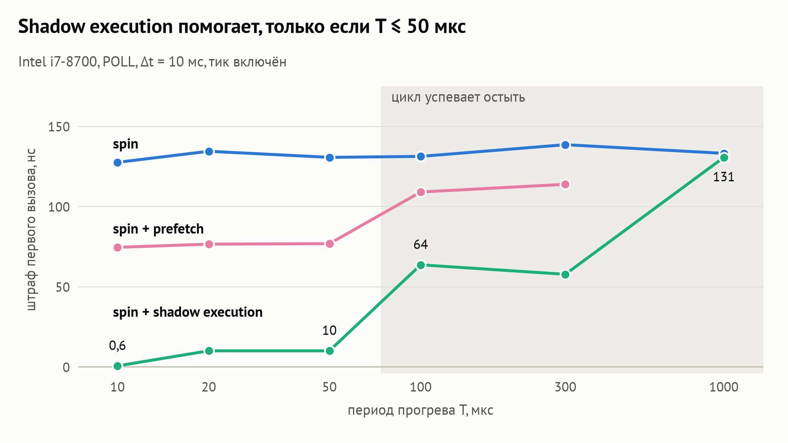
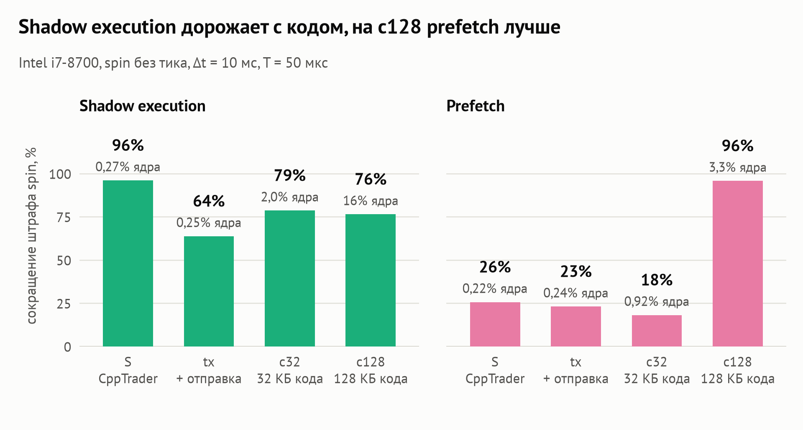
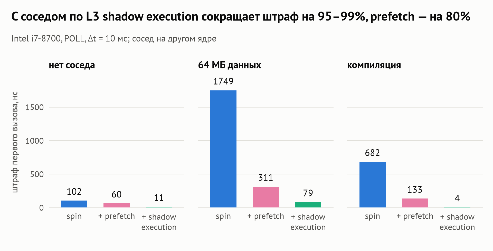

# Prefetch: прогрев без исполнения обработчика

**Вопрос.** Можно ли вместо shadow execution ([shadow.md](shadow.md)) заранее подгрузить код и данные обработчика в кэш инструкциями prefetch? Prefetch не исполняет код. Значит, ему не нужен безопасный режим dry run, и стоит он дешевле. А что из потерянного за паузу он возвращает?

**Откуда идея.** Shadow execution требует, чтобы обработчик можно было безопасно прогнать в режиме dry run. Это возможно не всегда, а prefetch обходится без этого. Есть и вторая причина. Prefetch возвращает только кэши. Поэтому сравнение с shadow execution показывает, что именно теряется за паузу, кэши или фронтенд.

**Коротко.**

- Prefetch возвращает данные в L1d, а код только в L2. Заодно он возвращает трансляцию адресов (TLB). L1i, uop cache, BTB и предсказатель переходов он не возвращает. Их заполняет только исполнение кода.
- После сна prefetch заранее (`pfwake`) сокращает штраф на ~60% после C3 и на ~50% после C6. Prewake сокращает его почти до нуля.
- Prefetch в момент события (`pfevent`) почти бесполезен. Исключение составляют данные, которые обработчик читает цепочкой зависимых чтений. Там prefetch сокращает штраф на 74%.
- В busy-poll цикле маленький обработчик теряет в основном фронтенд. Поэтому prefetch там слабее shadow execution. Для большого кода (128 КБ) всё наоборот. Prefetch сокращает штраф на 96% за 3,3% ядра, а shadow execution сокращает его на 76% за 16%.
- Против соседа, который вытесняет общий L3, prefetch снижает штраф с 1749 до 311 нс за 0,2% ядра.

## Стенд

Стенд тот же, что для shadow execution ([shadow.md](shadow.md#стенд)). Метрики, счётчики и setup описаны в [README](../README.md#метрики-и-термины).

**Что подгружается** ([prefetch.cpp](../src/bench/prefetch.cpp), сам проход в [`TPrefetcher::Run`](../src/bench/prefetch.cpp#L94-L115)).

- **Данные.** Это около 48 кэш-линий (блоков памяти по 64 байта), которые трогает событие. Сюда входят стакан, путь в дереве уровней цены, заявки и ячейка хеша. Их адреса отдаёт моя обёртка через открытые методы CppTrader ([`PrefetchData`](../src/handler/cpptrader.cpp#L521-L550)). Данные идут в L1d через `prefetcht0`.
- **Код.** Это около 80 кэш-линий в ~24 диапазонах. Я нахожу их при старте, пошагово трассируя один вызов (флаг TF и сигнал `SIGTRAP`, [`TraceCode`](../src/bench/prefetch.cpp#L56)). Код идёт в L2 через `prefetcht1`, потому что программно положить код в L1i на Intel нельзя.

| Режим | Что происходит за паузу Δt | Код |
| --- | --- | --- |
| `pfwake` | сон, пробуждение за δ до события (δ = 200 мкс), prefetch, остаток ожидания в цикле (аналог prewake) | [main.cpp L378](../src/bench/main.cpp#L378-L387) |
| `pfevent` | сон до события, prefetch прямо перед вызовом (момент события знать не нужно) | [main.cpp L574](../src/bench/main.cpp#L574) |
| `spinpf` | busy-poll цикл, prefetch каждые T (аналог `spinshadow`) | [main.cpp L388](../src/bench/main.cpp#L388-L400) |

В тех же запусках я замеряю сон без прогрева (`none`), цикл (`spin`), цикл с shadow execution (`spinshadow`) и prewake. Я пробую четыре набора адресов. Это только данные, только код, оба набора сразу и пустой набор. Пустой набор показывает, сколько даёт само пробуждение без prefetch.

## 1. Что prefetch возвращает, а что нет

**Откуда идея.** Мне хотелось разделить потери после сна на кэши и фронтенд. Prefetch трогает только кэши, а prewake исполняет весь код. Значит, разница между ними и есть вклад фронтенда.

**Гипотеза.** Prefetch вернёт кэши (данные, код до L2) и TLB, но не фронтенд. То есть не L1i, не uop cache, не BTB и не предсказатель переходов.

**Что сделал.** Запустил `bench` со сном 10 мс и политикой по умолчанию (C6 и глубже). Замерил режимы `none`, `pfwake` с кодом и данными и `prewake`. Отдельными запусками записал счётчики первого вызова через `rdpmc`, группы a–d ([counters.cpp](../src/bench/counters.cpp), флаг `--group`, серии в [pf.sh](../pf.sh), разбор в [pf.py](../pf.py)).

**Результат.** Гипотеза подтвердилась. Счётчики первого вызова после C6:

| | Сон | Prefetch | Prewake | Горячий |
| --- | --- | --- | --- | --- |
| промахи L1d | 68 | 11 | 4 | 0,4 |
| код из L3 мимо L2 | 262 | 92 | 1 | 0,4 |
| обходы таблиц страниц, данные / код | 14 / 14 | 2 / 0 | 1 / 0 | 0 / 0 |
| промахи L1i | 334 | 291 | 7 | 2 |
| branch misses | 32 | 34 | 9,5 | 0,8 |
| BTB re-steers | 92 | 93 | 17 | 0 |
| uops из uop cache | 23 | 41 | 81 | 421 |

## 2. Prefetch перед событием после сна

**Откуда идея.** Это прямой аналог prewake. Если момент события известен, можно проснуться заранее и сделать prefetch вместо прогона.

**Гипотеза.** Prefetch заранее сокращает штраф после сна на ту часть, которая приходится на кэши.

**Что сделал.** Запустил `bench` с Δt = 10 мс и политиками «до C3» и «по умолчанию». В режиме `pfwake` ядро просыпается за 200 мкс, делает prefetch за 20 мкс до события и ждёт в цикле. На каждую клетку 5 запусков по 1000 испытаний ([pf.sh](../pf.sh)).

**Результат.** Штраф первого вызова, нс:

| | после C3 | после C6 |
| --- | --- | --- |
| сон без прогрева | 432 | 963 |
| `pfwake`, код и данные | 162 | 490 |
| `pfwake`, пробуждение за 150 мкс (1 запуск) | 67 | 487 |
| prewake | 7 | 83 |

- После C6 разрыв с prewake около 400 нс. Это как раз предсказатель переходов, BTB и L1i из раздела 1.
- Проснуться заранее и ничего не делать хуже, чем спать (671 против 432 нс после C3). Пока ядро ждёт в цикле, оно остывает. Поэтому чем ближе прогрев к событию, тем лучше.
- Один проход prefetch сразу после пробуждения стоит 400–500 нс, потому что сама таблица адресов холодная. В тёплом цикле проход стоит 120–130 нс.

## 3. Prefetch в момент события

**Откуда идея.** Часто момент события заранее не известен. Тогда остаётся сделать prefetch уже по факту события. В литературе по программному prefetch пишут, что он окупается в основном там, где процессор сам не может перекрыть промахи. Например, при обходе цепочки указателей. На S он не окупился, поэтому я проверил этот случай на синтетическом обработчике.

**Гипотеза.** Prefetch в момент события окупится, только если обработчик читает данные цепочкой зависимых чтений.

**Что сделал.**

- На обработчике S замерил режим `pfevent` с данными и с кодом и данными, после C3 и после C6 ([pf.sh](../pf.sh)).
- Взял синтетический обработчик с 64 КБ данных ([src/handler/synth.cpp](../src/handler/synth.cpp)) в двух вариантах. d64 читает данные цепочкой, d64i читает их независимо. Запускал его с политикой «до C3» в режимах `pfwake` и `pfevent`, 2 запуска ([size.sh](../size.sh), серия F).

**Результат.** Обработчик S, штраф первого вызова, нс:

| Сон | Без прогрева | `pfevent`, данные | `pfevent`, код и данные | `pfwake`, код и данные |
| --- | --- | --- | --- | --- |
| C3 | 432 | 354 | 415 | 162 |
| C6 | 963 | 964 | 1006 | 490 |

На синтетике после C3 у d64 (цепочка) `pfevent` сокращает штраф на 74%, а `pfwake` на 98%, даже больше prewake. У d64i (независимые чтения) с `pfevent` штраф больше, чем без prefetch.

Выходит, prefetch в момент события выгоден, только когда процессор сам не может перекрыть промахи. При независимых чтениях он лишь занимает пропускную способность памяти.

## 4. Prefetch в busy-poll цикле

**Откуда идея.** Когда выяснилось, что busy-poll цикл остывает (shadow.md, раздел 1), я захотел понять, какая часть этого остывания приходится на кэши.

**Гипотеза.** В цикле на выделенном ядре prefetch каждые T снимет ту часть остывания, которая приходится на кэши.

**Что сделал.** Запустил `bench` при Δt = 10 мс в режимах `spin`, `spinpf` и `spinshadow` с T = 50 мкс. Сначала мерил с тиком таймера (5 запусков по 1000, [pf.sh](../pf.sh)), потом без тика (`nohz_full`, 3 запуска, [size.sh](../size.sh)).

**Результат.**

| | `spin` | `spinpf` | `spinshadow` | Цена prefetch |
| --- | --- | --- | --- | --- |
| тик есть | 145–149 нс | 78–80 нс (половина) | 7–28 нс | 0,25% ядра |
| без тика | 62 нс | сокращение на 26% | сокращение на 96% | 0,22% ядра |

С тиком prefetch сокращает штраф вдвое. Тик вытесняет до 53 кэш-линий кода из L2 и 8–14 кэш-линий данных из L1d, а prefetch их возвращает. Без тика остаётся остывание фронтенда (~12 промахов L1i и ~12 BTB re-steers за 10 мс). Тут prefetch почти бесполезен.

## 5. Большой код: prefetch дешевле shadow execution

**Откуда идея.** Мой обработчик S маленький. Для больших обработчиков выбор стратегии может оказаться другим. Поэтому prefetch я тоже проверил на обработчиках разного размера.

**Гипотеза.** Код, который больше L1i (32 КБ), всё равно живёт в L2. Тогда у большого обработчика prefetch кода в L2 вернёт почти всё, что возвращает shadow execution. А стоить он будет намного меньше, ведь проход prefetch короче прогона.

**Что сделал.** Взял те же варианты обработчика, что в [shadow.md](shadow.md#4-размер-обработчика-и-цена-shadow-execution). Это S, tx, c32 (32 КБ кода), c128 (128 КБ) и big (128 КБ кода, 64 КБ данных модели и отправка). Мерил без тика, с Δt = 10 мс и T = 50 мкс, 3 запуска ([size.sh](../size.sh), разбор в [size.py](../size.py)). Отдельно замерил сон в C6 и C3.

**Результат.** Busy-poll цикл:

| Вариант | Штраф `spin`, нс | Prefetch, сокращение / цена | Shadow execution, сокращение / цена |
| --- | --- | --- | --- |
| S | 62 | 26% / 0,22% | 96% / 0,27% |
| c32 | 169 | 18% / 0,9% | 79% / 2,0% |
| c128 | 271 | **96% / 3,3%** | 76% / 16% |
| big | | — / 6,5% | — / 47% |

- После C6 prefetch кода слабеет с ростом кода. `pfwake` сокращает штраф на 57% у S и на 20% у c128. Код через L2 возвращается, а предсказатель и BTB не возвращаются.
- После C3 у c128 `pfwake` сокращает штраф на 60–63%, а prewake на 86–87%.

## 6. Сосед по общему L3

**Откуда идея.** Серия с соседом показала, что сосед по L3 ухудшает первый вызов даже на ядре в busy-poll цикле (shadow.md, раздел 6). Сосед вытесняет именно кэш-линии. А возвращать кэш-линии prefetch как раз умеет.

**Гипотеза.** Prefetch в цикле вернёт большую часть того, что отнимает сосед.

**Что сделал.** Запускал `bench` только с POLL и Δt = 10 мс. На ядре 4 при этом работает сосед ([iso.sh](../iso.sh), уровень `l3`). Он либо проходит по 64 МБ данных, либо компилирует проект через `g++`. Замерил режимы `spin`, `spinpf` и `spinshadow`, на каждую клетку 5 тысяч испытаний ([iso-night.sh](../iso-night.sh), разбор в [iso.py](../iso.py)).

**Результат.** Штраф первого вызова, нс, p50 / p99:

| Сосед | `spin` | `spinpf` | `spinshadow` |
| --- | --- | --- | --- |
| нет | 102 / 178 | 60 / 141 | 11 / 67 |
| 64 МБ данных | 1749 / 2507 | 311 / 713 | 79 / 346 |
| компиляция | 682 / 1408 | 133 / 521 | 4 / 202 |

Prefetch сокращает штраф `spin` на 80–82% за 0,19–0,21% ядра. Shadow execution сокращает его на 95–99% за 0,24–0,33%.

## Когда что применять

| Ситуация | Prefetch или shadow execution |
| --- | --- |
| Обработчик нельзя безопасно прогнать в режиме dry run | prefetch, он не исполняет код |
| Маленький обработчик в цикле | shadow execution. Остывает фронтенд, и prefetch его не вернёт |
| Большой код (от 128 КБ) в цикле | prefetch кода в L2. Почти как shadow execution, но в 5 раз дешевле и без столкновений с событиями |
| Данные читаются цепочкой, момент события неизвестен | prefetch в момент события |
| После глубокого сна, момент события известен | prewake. Prefetch здесь вдвое хуже |

## Ограничения

- Все числа получены на одной машине (Intel Coffee Lake).
- Наборы кэш-линий собраны для одного события. Если событие идёт другим путём через стакан, набор нужно собирать заново.
- Адреса кода находятся трассировкой при старте. При другой раскладке (ASLR, новый бинарник) их нужно искать снова.
- В большинстве серий от 1 до 5 запусков по 1000 испытаний.
