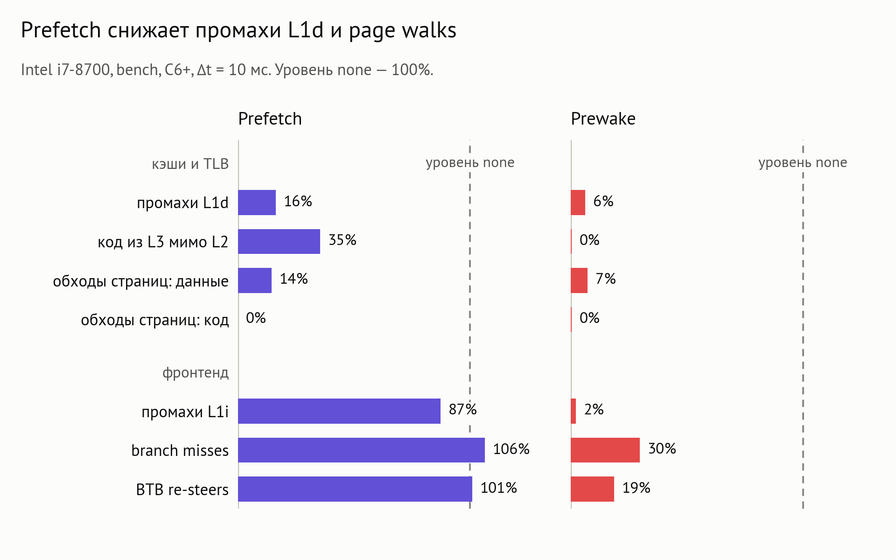
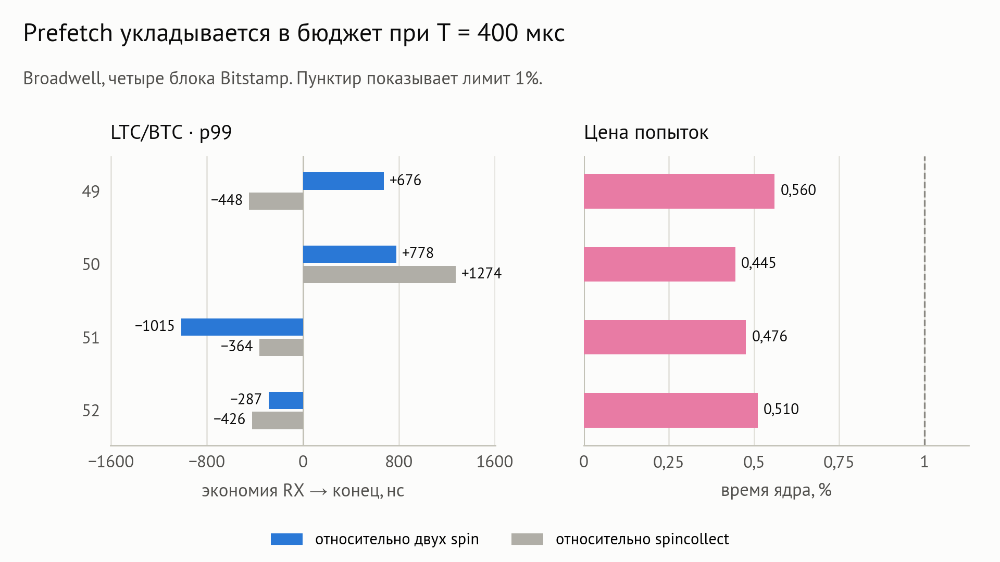

# Prefetch: прогрев без исполнения обработчика

**Вопрос.** Что prefetch возвращает после паузы и сколько стоит сбор адресов? Как и [shadow execution](shadow.md), prefetch можно запустить заранее. Для него не нужен режим dry run.

**Коротко.** В `bench` prefetch уменьшает штраф после сна и помогает при вытеснении из L3. На Bitstamp replay основная цена приходится на сбор адресов, а выигрыш по полному p99 меняется от блока к блоку.

## Стенд

В разделах 1–6 я использую `bench` на Intel i7-8700 (Coffee Lake). Базовый обработчик S — CppTrader на фиксированном стакане SPY. Штраф — разница между временем первого вызова и медианой горячего вызова в том же запуске. На графиках штрафа показан p50. Bitstamp replay на Broadwell — отдельный опыт в разделе 7. [Стенд](shadow.md#стенд) · [Метрики и setup](../README.md#метрики-и-термины)

Для `bench` я заранее собираю адреса кода и данных одного вызова. [`TPrefetcher::Run`](../src/bench/prefetch.cpp#L94-L115)

- **Данные.** Около 48 кэш-линий стакана, уровней цены, заявок и хеша. Для них выдаю `prefetcht0` с целью L1d. [`PrefetchData`](../src/handler/cpptrader.cpp#L521-L550)
- **Код.** Около 80 кэш-линий в 24 диапазонах. Нахожу их при старте, пошагово трассируя один вызов с TF и `SIGTRAP`. Для этих адресов выдаю `prefetcht1` с целью L2. [`TraceCode`](../src/bench/prefetch.cpp#L56)

- `pfwake` — раннее пробуждение с prefetch. [main.cpp](../src/bench/main.cpp#L411)
- `pfevent` — prefetch перед обработкой события, его время входит в окно замера. [main.cpp](../src/bench/main.cpp#L618)
- `spinpf` — prefetch каждые T в busy-poll цикле. [main.cpp](../src/bench/main.cpp#L421)

## 1. Что prefetch возвращает, а что нет

**Что сделал.** После 10 мс сна с политикой по умолчанию (C6 и глубже) сравнил `none`, `pfwake` с кодом и данными и `prewake` с shadow execution. Счётчики первого вызова снимал через `rdpmc` в отдельных запусках, по группам a–d. [pf.sh](../pf.sh) · [counters.cpp](../src/bench/counters.cpp)

**Результат.** После `pfwake` промахи L1d снизились с 68 до 11, fetch кода из L3 мимо L2 — с 262 до 92. Обходы таблиц страниц тоже сократились. Промахи L1i сохранились на уровне 87% от сна, а branch misses и re-steers остались близки к baseline. После `prewake` эти счётчики снижались сильнее. Re-steers (`BACLEARS.ANY`) дают косвенный признак для BTB.

## 2. Prefetch перед событием после сна

**Что сделал.** При Δt = 10 мс сравнил политики «до C3» и «по умолчанию». В `pfwake` просыпался за 200 мкс, выдавал prefetch кода и данных за 20 мкс до события и ждал в цикле. На каждую клетку 5 запусков по 1000 испытаний. [pf.sh](../pf.sh)

**Результат.** `pfwake` сократил штраф на 63% с политикой до C3 и на 49% с политикой по умолчанию. В обоих случаях у `prewake` остаточный штраф был ниже. На графике время первого вызова относительно горячего. Время пробуждения сюда не входит.

При политике до C3 раннее пробуждение с пустым набором адресов дало 671 нс штрафа против 432 нс в `none`. В отдельном опыте с пробуждением за 150 мкс `pfwake` дал 67 нс при политике до C3 и 487 нс при политике по умолчанию, по одному запуску на политику.

Один проход по уже известным адресам занимал 400–500 нс после пробуждения и 120–130 нс в тёплом цикле.

## 3. Prefetch в момент события

**Что сделал.** На S сравнил `pfevent` для данных и для кода с данными при двух политиках сна. С политикой до C3 повторил сравнение на двух синтетических обработчиках с 64 КБ данных. d64 читает данные цепочкой, d64i — независимыми чтениями. [pf.sh](../pf.sh) · [size.sh, серия F](../size.sh) · [synth.cpp](../src/handler/synth.cpp)

**Результат.** На S при политике до C3 prefetch данных в момент события снизил штраф с 432 до 354 нс, добавление кода дало 415 нс. При политике по умолчанию штраф остался около 1 мкс. На d64 `pfevent` сократил штраф на 74%, на d64i штраф вырос.

## 4. Prefetch в busy-poll цикле

**Что сделал.** При Δt = 10 мс и T = 50 мкс сравнил `spin`, `spinpf` и `spinshadow` с тиком таймера и в отдельной серии с `nohz_full`. [pf.sh](../pf.sh) · [size.sh](../size.sh)

**Результат при 50 мкс.** С тиком `spinpf` снизил штраф со 145–149 до 78–80 нс за 0,25% ядра. С `nohz_full` штраф `spin` составил 62 нс. Prefetch снял 26% за 0,22% ядра, shadow execution — 96%.

В отдельной серии по T с POLL и тиком штраф `spinpf` составил 74–77 нс при T = 10–50 мкс и 109–114 нс при T = 100–300 мкс. [График по периодам](shadow.md#2-какой-нужен-период-t)

## 5. Большой код: prefetch дешевле shadow execution

**Что сделал.** Сравнил варианты обработчика от S до c128 со 128 КБ сгенерированного кода. В цикле использовал `nohz_full`, Δt = 10 мс, T = 50 мкс и три запуска на вариант. Отдельно замерил политики сна до C3 и по умолчанию. [size.sh](../size.sh)

**Результат.** В busy-poll на c128 `spinpf` снял больше штрафа, чем `spinshadow`, при меньшей цене на ядре. При политике сна по умолчанию `pfwake` снял 57% штрафа у S и 20% у c128. График относится к busy-poll. [График по размерам](shadow.md#4-размер-обработчика-и-цена-shadow-execution)

## 6. Сосед по общему L3

**Что сделал.** При POLL и Δt = 10 мс запустил на другом ядре того же LLC запись в массив 64 МиБ или компиляцию. Сравнил `spin`, `spinpf` и `spinshadow`. [iso-night.sh](../iso-night.sh) · [График штрафа p50](shadow.md#6-сосед-по-общему-l3)

**Результат.** В двух сценариях с соседом prefetch снял 80–82% штрафа по p50 за 0,19–0,21% ядра. При записи в массив p99 штрафа снизился с 2507 до 713 нс. Разделение LLC через Intel CAT я проверял отдельно, на Broadwell. [Intel CAT](baselines.md#2-intel-cat-при-общем-llc)

## 7. Prefetch данных на Bitstamp

На feed заявки меняются. Перед каждой попыткой `spinpf` обходит стакан и выдаёт `prefetcht0`. Контроль `spincollect` выполняет тот же сбор адресов. [Код приёмника](../src/recv/main.cpp)

**Что сделал.** На Xeon E5-2650L v4 после серии с T = 200 мкс проверил T = 400 мкс на четырёх других десятиминутных блоках той же записи. Каждый блок подавал на четыре multicast-приёмника. Два `spin` служили baseline, ещё два работали как `spincollect` и `spinpf`. Менял роли между ядрами, сверял ID и хеши стакана. Метрика — p99 LTC/BTC от программной RX-метки до конца обработки. [Запуск replay](../online.sh)

**Результат.** В первой серии с 200 мкс prefetch выходил за лимит 1% в семи блоках из восьми. При 400 мкс попытки занимали **0,445–0,560%** ядра. Полный p99 улучшился в двух блоках из четырёх относительно среднего двух `spin`. Средний выигрыш по блокам составил 38 нс относительно baseline и 9 нс относительно `spincollect`.

На совпадающих ID с одной успешной попыткой и одинаковым числом кэш-линий медиана сбора составила **2,07–2,61 мкс** по блокам. Медиана парной разности между полной попыткой и сбором составила 43–122 нс. Обход стакана сам читает данные и может прогреть их. В каждом блоке режимы работали на разных CPU.

**Контроль A/A.** У двух `spin` полный p99 расходился на 305–1264 нс. Отдельная перестановка сокетов показала, что порядок регистрации влияет на задержку до userspace. На этой записи оставляю `spin`. [Контроль порядка сокетов](shadow.md#replay-на-broadwell-с-одним-приёмником)

## Когда что применять

Если dry run недоступен, prefetch позволяет проверить выигрыш от подачи кода или данных отдельно. Для цикла с меняющимся стаканом я сначала меряю цену обхода и сравниваю её с полной попыткой `spinpf`.

## Ограничения

- В `bench` набор кэш-линий собран для одного события. Другой путь через стакан или другая раскладка кода требуют нового набора.
- На Bitstamp проверял только prefetch данных. Эффект относительно `spin` и `spincollect` оценивал на одной записи с ротацией по ядрам.
