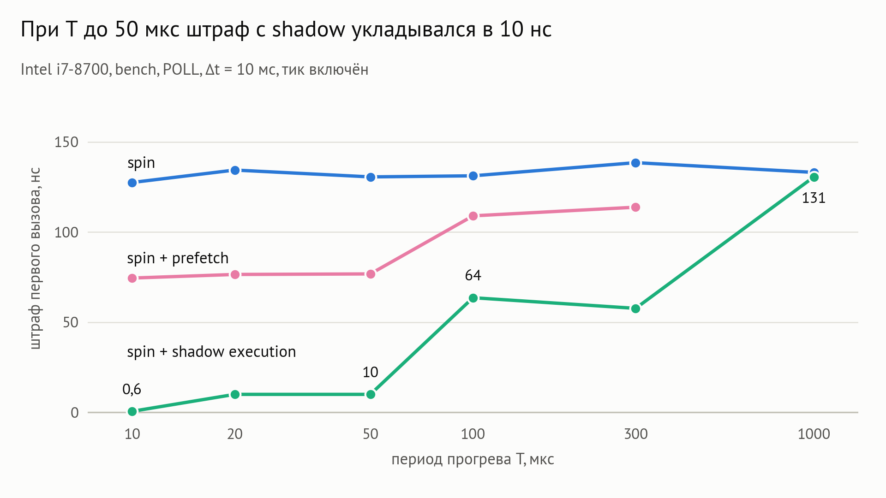
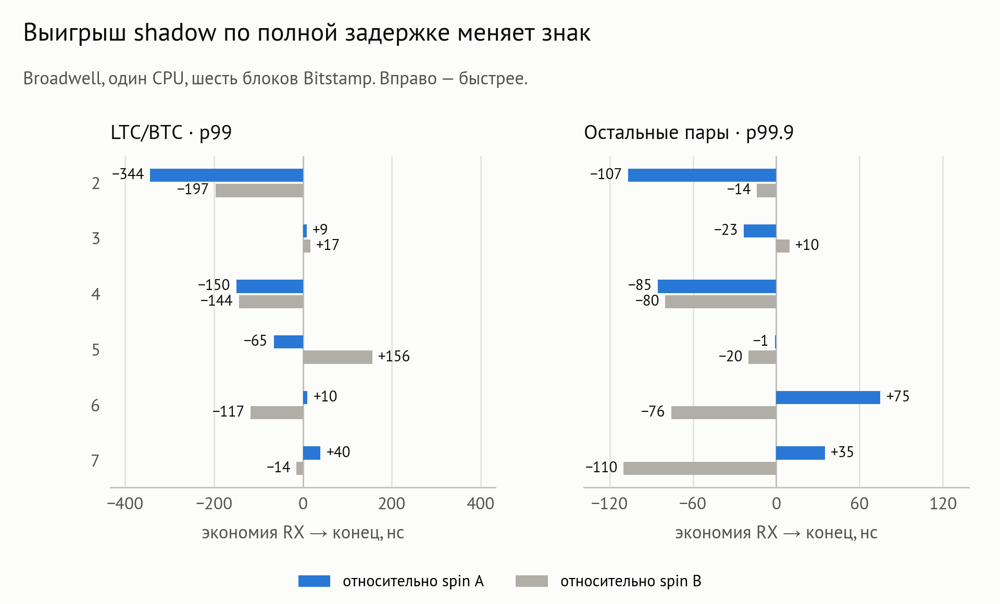
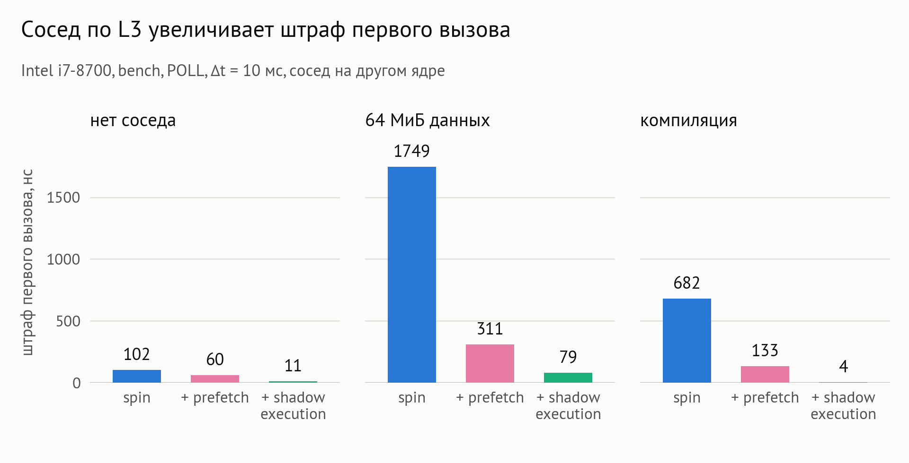

# Shadow execution: прогрев обработчика прогоном в режиме dry run

**Вопрос.** Насколько первый вызов редкого обработчика медленнее горячего и можно ли сократить этот штраф прогоном в режиме dry run?

**Коротко.** В `bench` на Coffee Lake shadow сокращает штраф первого вызова даже на выделенном ядре в busy-poll. В Bitstamp replay на Broadwell средний p99 внутри обработчика снизился. Для задержки от RX до конца обработки я оставляю `spin` как baseline.

## Стенд

В сериях `bench` я использую Intel i7-8700 (Coffee Lake), одно ядро на 3,2 ГГц, SMT и turbo выключены. Обработчик S — CppTrader со стаканом SPY из Nasdaq BX. Событие состоит из Add Order по лучшему bid и Delete той же заявки. После 64 горячих вызовов идёт пауза Δt, затем 8 замеров. Штраф — p50 первого вызова минус p50 горячего в том же запуске. Горячий вызов S занимает 117 нс. Задержку «событие → конец» отсчитываю от заданного срока события. [CppTrader](https://github.com/chronoxor/CppTrader) · [Метрики и setup](../README.md#метрики-и-термины) · [bench](../src/bench/main.cpp)

| Режим | Во время паузы |
| --- | --- |
| `spin` | busy-poll цикл с опросом часов и `pause` |
| `spinshadow` | тот же цикл и shadow execution каждые T |
| `none` | сон |
| `shadow` | сон с пробуждениями каждые T для shadow execution |
| `prewake` | сон, shadow execution за δ до события и busy-poll до его начала |

В `bench` shadow вызывает `Handle(event, dryRun = true)`. Стратегия проходит путь события без отправки заявки. По умолчанию в сериях с busy-poll разрешён только POLL. [Handle](../src/handler/cpptrader.cpp#L508-L517) · [cstate.sh](../cstate.sh)

## 1. Остывает ли ядро, которое не спит

**Что сделал.** При Δt = 10 мс сравнил `spin` и `spinshadow` с T = 50 мкс. Основная серия — пять запусков по 1000 испытаний. Отдельно снял серию с `nohz_full`. [pf.sh](../pf.sh) · [size.sh](../size.sh)

**Результат.** С тиком штраф `spin` составил 145–149 нс. С shadow — 7–28 нс за 0,2% времени ядра. Медиана от срока события до конца обработки снизилась с 0,4 до 0,3 мкс. В серии с `nohz_full` штраф `spin` был 62 нс, shadow сократил его на 96% за 0,27% ядра. В первом вызове насчитал около 12 промахов L1i и 12 перенаправлений выборки, которые использую как косвенный признак состояния BTB. [Счётчики](../src/bench/counters.cpp)

## 2. Какой нужен период T

**Что сделал.** При Δt = 10 мс и включённом тике менял T от 10 мкс до 1 мс. На каждое значение пришлось от двух до пяти запусков. [pf.sh](../pf.sh)

**Результат.** На 50 мкс shadow снимал большую часть штрафа за 0,2% ядра. На 100 и 300 мкс оставалось порядка половины штрафа `spin`, на 1 мс эффект практически исчез. Это измерение периода прогрева S при заданном режиме ожидания.

| T, мкс | 10 | 50 | 100 | 1000 |
| --- | ---: | ---: | ---: | ---: |
| Штраф `spinshadow`, нс | 0,6 | 10 | 64 | ~130 |
| Цена, % ядра | 1,2 | 0,2 | 0,2 | 0,02 |

## 3. Shadow execution через сон

**Что сделал.** При Δt = 10 мс и политике сна по умолчанию (C6 и глубже) сравнил `none`, `shadow` с T = 1 мс и `prewake` с δ = 200 мкс. Повторил опыт на обработчиках разного размера. [size.sh](../size.sh)

**Результат.** У S штраф составил 938–963 нс после обычного сна, 935 нс при периодическом shadow и 83 нс при `prewake`. У разных обработчиков `prewake` снимал 81–96% штрафа. Для большого кода после 1, 2 и 4 прогонов оставалось 17, 6 и 1% штрафа. При пробуждении каждые 100 мкс ядро оставалось в C1E или более активных состояниях, а штраф S снижался с 948 до 45 нс. Влияние самого пробуждения на задержку до конца обработки проверил отдельно. [Контроль C-states](baselines.md#3-контроль-c-states)

## 4. Размер обработчика и цена shadow execution

**Что сделал.** Собрал варианты S с отправкой через `sendto` (`tx`), с 32 или 128 КБ сгенерированного кода (`c32`, `c128`) и `big` с кодом, чтением данных модели, риск-проверками и отправкой. В `big` модель читает 1024 кэш-линии по цепочке зависимых адресов. Сравнил режимы с `nohz_full` при Δt = 10 мс и T = 50 мкс, три запуска по 1000 испытаний. Отдельно записал 20 тысяч событий со случайной фазой. [Генератор](../gen-code.py) · [size.sh](../size.sh) · [Чтения модели](../src/handler/load.cpp#L69-L97)

**Результат.** График сравнивает, какую долю штрафа `spin` снимают shadow execution и prefetch и сколько стоит каждый режим. На `c128` shadow снимал 76% штрафа за 16% ядра, prefetch — 96% за 3,3%. [Prefetch](prefetch.md)

У `big` горячий baseline смещён, поэтому для него я сравниваю абсолютное время. Первый вызов занимает 32,2 мкс со `spin` и 27,7 мкс с shadow за 47% времени ядра. При случайной фазе примерно половина событий ждала конца прогона. В этой серии p99 «событие → конец» вырос с 31,2 мкс на фиксированной сетке до 50,9 мкс. Сгенерированный код предсказуемее кода настоящего обработчика.

В отдельном опыте с `tx` после сна `prewake` без отправки оставил 81% штрафа. С пробной UDP-отправкой в `dummy0` осталось 12%. [Код отправки](../src/handler/send.cpp) · [Настройка dummy0](../setup-tx.sh)

## 5. Bitstamp feed и replay

На Bitstamp я отдельно считаю время обработчика и задержку от программной RX-метки до конца обработки. Вторая величина включает ожидание до userspace. В ранней серии конец оцениваю как вход в userspace плюс время обработчика. В replay на Broadwell беру прямую метку конца. Shadow делает Add и Delete по текущему bid на реальном стакане в режиме dry run. Редкая пара — LTC/BTC. [feed](../src/feed/) · [Shadow](../src/handler/cpptrader.cpp#L588-L602) · [online.sh](../online.sh) · [Границы задержки](../online.py#L49-L52)

### Живой feed на Coffee Lake

**Что сделал.** Подавал живой Bitstamp feed из 31 пары в архитектуре A и только LTC/BTC в B. Снял 28 блоков A и 32 блока B по 10 минут. Четыре multicast-приёмника получали одинаковые пакеты, а режимы менялись местами между ядрами после каждого блока. Для `spinshadow` использовал T = 50 мкс. [Разбор хвостов](../tails.py)

**Результат.** В архитектуре B p999 внутри обработчика снизился с **1222 до 907 нс**, а полный p999 составил **9,78 и 9,75 мкс** у `spin` и `spinshadow`. В архитектуре A p999 внутри редкого обработчика составил 833 и 771 нс, полный p999 — 9,45 и 9,46 мкс.

У остальных пар в архитектуре A полный p999 вырос с 9,38 до 9,49 мкс. Разность между одинаковыми режимами на двух ядрах в A/A составляла около 0,6 мкс по медиане модуля. Сон поднял p999 почти до 64 мкс. Окончание прогрева оказалось ближе 2 мкс к концу обработки у 4,5% пакетов других пар. Это оценка близости по меткам времени.

### Replay на Broadwell с одним приёмником

**Что сделал.** Четыре одинаковых `spin` получили один feed с прямым и обратным порядком регистрации multicast-сокетов. Медиана RX → userspace у CPU5 относительно CPU2 менялась с +270…+283 до −212…−181 нс. Поэтому следующий replay на Xeon E5-2650L v4 шёл с одним приёмником на CPU2. На каждый блок приходилось два запуска `spin` и один shadow с T = 200 мкс. Я менял порядок запусков и сверял ID, сигналы и конечный хеш стакана.

С обычным `spinshadow` новый пакет откладывал следующую попытку прогрева. Для целевого таймера я отсчитывал T от последнего LTC/BTC или последней попытки. Прогрев запускался при пустом сокете.

**Результат.** В каждом блоке вычитаю p99 shadow из среднего p99 двух `spin`. Блоки имеют равный вес. Плюс означает меньшую задержку.

| Replay | Экономия p99 обработчика LTC/BTC | Экономия полного p99 LTC/BTC |
| --- | ---: | ---: |
| Обычный `spinshadow`, 4 блока первой записи | +44 нс, быстрее в 4/4 | −10 нс |
| Целевой таймер, 6 блоков новой записи из 31 пары | +19 нс, быстрее в 5/6 | −67 нс, 95%-й интервал −194…+60 нс |

На шести блоках с целевым таймером попытки заняли **0,27–0,29%** времени ядра. Полный p999 остальных пар вырос в среднем на 33 нс. В трёх дополнительных парных сравнениях таймеров я выделил пакеты LTC/BTC после паузы ≥100 мс, пришедшие менее чем через 200 мкс после предыдущего пакета любой пары. Доля этой группы со свежим прогревом выросла с **14–17% до 98–99%**.

## 6. Сосед по общему L3

**Что сделал.** Запускал `bench` на Coffee Lake с POLL и Δt = 10 мс. На другом ядре сосед писал в массив 64 МиБ или компилировал проект через `g++`. В каждом запуске было 5 тысяч испытаний. [iso.sh](../iso.sh) · [iso-night.sh](../iso-night.sh)

**Результат.** С соседом, который пишет в массив, медианный штраф `spin` вырос со 102 до 1749 нс. Shadow снизил его до 79 нс за 0,24–0,33% ядра. В том же сравнении p99 штрафа снизился с 2507 до 346 нс. Возможное объяснение — вытеснение кода и данных из общего L3. Отдельно проверил, как меняется задержка при разделении путей LLC на Broadwell. [Intel CAT](baselines.md#2-intel-cat-при-общем-llc)

## 7. Тик таймера

**Что сделал.** При `nohz_full=2-5 rcu_nocbs=2-5` измерил `spin` и `spinshadow` при Δt = 10 мс. Сравнил варианты с частотным событием `perf record -F 1` на ядре замера и без него. В каждом запуске было 20 тысяч испытаний. Цикл записывал последний разрыв опроса дольше 1 мкс. [nzt.sh](../nzt.sh) · [SpinUntil](../src/bench/main.cpp#L465-L480)

**Результат.** График объединяет оба запуска. Медианный штраф `spin` составил 52 нс без обнаруженного разрыва, 23 нс при разрыве менее 50 мкс назад и 103 нс в группе 100 мкс – 1 мс. У `spinshadow` в последней группе — около 3 нс. В варианте без `perf` на ядре сохранялось 821–870 тиков в секунду. Разрывы дают косвенную оценку прерываний. По этому графику можно судить о связи штрафа с давностью разрыва.

