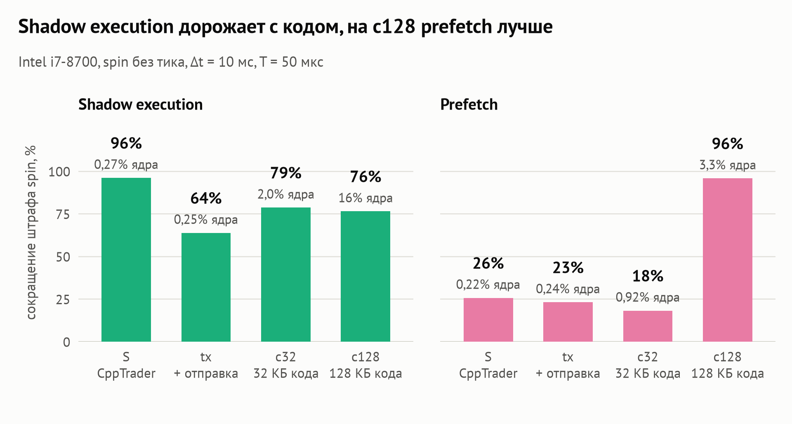
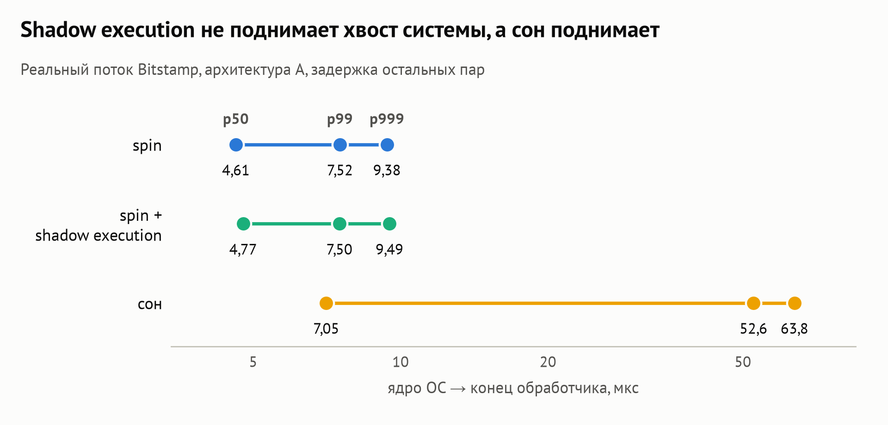
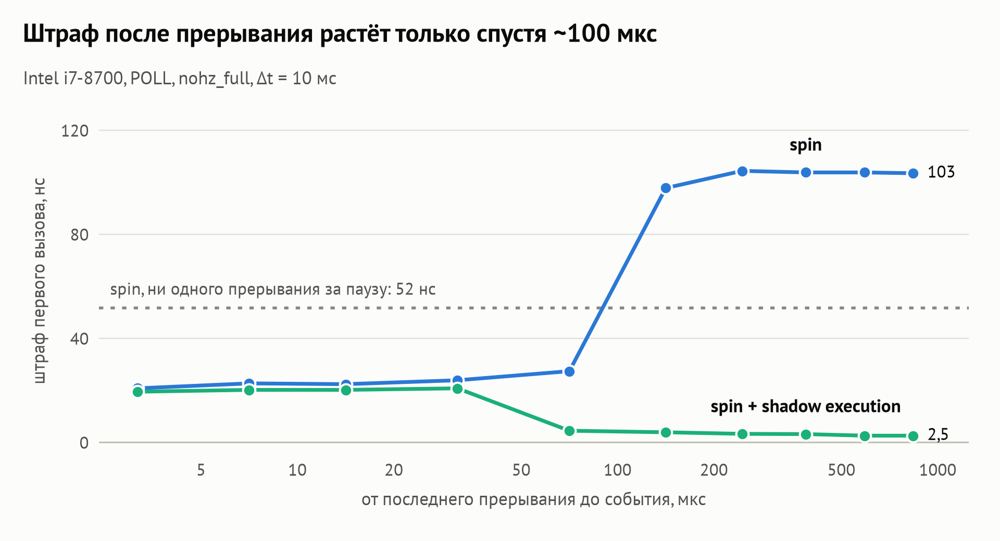

# Shadow execution: прогрев обработчика прогоном в режиме dry run

**Вопрос.** Торговый обработчик редкого события (редко торгуемый инструмент, редкий сигнал) вызывается раз в миллисекунды или секунды. Насколько его первый вызов после паузы медленнее горячего? И помогает ли заранее прогонять его по тому же пути, но без побочных эффектов? Такой прогон называется shadow execution.

**Откуда идея.** Shadow execution — самый прямой способ прогрева. Обработчик проходит тот же код по тем же данным, просто ничего не отправляет. С него я и начал. На нём быстрее всего увидеть эффект, а заодно проверить весь стенд целиком.

**Коротко.**

- Даже выделенное ядро, которое не спит и выполняет busy-poll цикл, остывает. Первый вызов на 130–150 нс дольше горячего (117 нс). Shadow execution каждые 50 мкс сокращает штраф почти до нуля и тратит на это 0,2–0,3% ядра.
- Период прогрева должен быть короче времени остывания цикла (~100 мкс). При T ≥ 100 мкс shadow execution почти бесполезен.
- Через глубокий сон (C3/C6) периодический shadow execution не работает. Следующий же сон стирает прогрев. Если момент события известен, помогает прогон прямо перед ним (prewake).
- Цена shadow execution растёт с размером обработчика. У маленького это 0,27% ядра, у большого (~30 мкс) уже 47%. К тому же у большого прогоны начинают сталкиваться с событиями.
- На реальном потоке shadow execution снижает p999 редкого обработчика с 1222 до 907 нс. Хвост остальных инструментов при этом не выходит за шум A/A.
- Сосед по общему L3 делает первый вызов в цикле в 17 раз дороже. Shadow execution возвращает его к ~80 нс.

## Стенд

Метрики, термины, setup и источники описаны в [README](../README.md#метрики-и-термины). Здесь только то, что нужно для этого документа.

- **Машина.** Intel i7-8700 (Coffee Lake), SMT и turbo выключены, частота 3,2 ГГц. Замер идёт на ядре 5. Политику простоя задаёт [cstate.sh](../cstate.sh). Значение `0` оставляет только POLL, как на критичном ядре в проде. С `3` ядро может уходить до C3. Значение `9` оставляет настройку по умолчанию (C6 и глубже).
- **Обработчик S.** Это [CppTrader](https://github.com/chronoxor/CppTrader) без изменений, на стакане SPY за день Nasdaq BX 30.07.2019. В качестве события я беру Add Order по лучшему bid и Delete этой заявки, так что стакан не меняется. Горячий вызов занимает 117 нс.
- **Shadow execution.** Это вызов `Handle(event, dryRun = true)`. Код и данные те же, но стратегия не отправляет заявку ([handler.h](../src/handler/handler.h#L21), [cpptrader.cpp](../src/handler/cpptrader.cpp#L503-L513), проверка `DryRun` в стратегии в [строках 72–77](../src/handler/cpptrader.cpp#L72-L77)).
- **Испытание `bench`** ([main.cpp](../src/bench/main.cpp), запуск через [run.sh](../run.sh)). Сначала идут 64 горячих вызова. Потом пауза Δt одним из способов. Потом 8 замеренных вызовов.

| Режим | Что происходит за паузу Δt | Код |
| --- | --- | --- |
| `spin` | busy-poll цикл (опрос часов и `pause`), без системных вызовов | [main.cpp L332](../src/bench/main.cpp#L332-L334), цикл [`SpinUntil`](../src/bench/main.cpp#L432-L444) |
| `spinshadow` | тот же цикл, каждые T — shadow execution | [main.cpp L335](../src/bench/main.cpp#L335-L348) |
| `none` | сон | [main.cpp L349](../src/bench/main.cpp#L349-L352) |
| `shadow` | сон с пробуждением каждые T и shadow execution | [main.cpp L353](../src/bench/main.cpp#L353-L365) |
| `prewake` | сон, пробуждение за δ до события (δ = 200 мкс), shadow execution, остаток ожидания в цикле | [main.cpp L366](../src/bench/main.cpp#L366-L377) |

## 1. Остывает ли ядро, которое не спит

**Откуда идея.** Сначала busy-poll цикл был у меня только способом ожидания для сравнения со сном. Но в latency-critical системах критичное ядро обычно вообще не спит. Поэтому цикл стал главным случаем.

**Гипотеза.** Я ожидал, что на выделенном ядре, которое выполняет busy-poll цикл, обработчику нечем остыть. Кэши ведь никто не трогает.

**Что сделал.** Запустил `bench` при Δt = 10 мс в режимах `spin` и `spinshadow` с T = 50 мкс, 5 запусков по 1000 испытаний ([pf.sh](../pf.sh)). Отдельно замерил ту же пару с `nohz_full=2-5`, то есть без тика таймера на ядре замера ([size.sh](../size.sh), серия B).

**Результат.** Гипотеза не подтвердилась. Цикл остывает.

| | Штраф первого вызова | Событие → конец | Цена |
| --- | --- | --- | --- |
| `spin` | 145–149 нс | 0,4 мкс | — |
| `spinshadow`, T = 50 мкс | 7–28 нс | 0,3 мкс | 0,2% ядра |
| `spin` без тика | 62 нс | | |
| `spinshadow` без тика | сокращение на 96% | | 0,27% ядра |

По счётчикам видно, что за 10 мс цикла теряется фронтенд. В первом вызове это ~12 промахов L1i и ~12 BTB re-steers. Данные остаются в кэше. Примерно половину остывания даёт тик таймера (раздел 7).

## 2. Какой нужен период T

**Откуда идея.** В цикле стоит детектор прерываний. Он показал, что обработчик теряет состояние примерно через 100 мкс без прерываний. Значит, прогревать нужно чаще, чем раз в 100 мкс.

**Гипотеза.** Shadow execution помогает, только если T короче времени, за которое цикл успевает остыть.

**Что сделал.** Прогнал `bench` в режиме `spinshadow` с T от 10 мкс до 1 мс при Δt = 10 мс. Тик таймера при этом работал. На каждое значение T от 2 до 5 запусков ([pf.sh](../pf.sh), [run.sh](../run.sh) с флагом `--period-us`).

**Результат.** Цикл остывает примерно за 100 мкс. Поэтому рабочий период получается 50 мкс и меньше.

| T, мкс | 10 | 50 | 100 | 1000 |
| --- | --- | --- | --- | --- |
| штраф с shadow execution, нс | 0,6 | 10 | 64 | ~130 |
| цена, % ядра | 1,2 | 0,2 | 0,2 | 0,02 |

Без прогрева (`spin`) штраф ~130 нс при любом T. У обработчиков с большим кодом при T = 200 мкс остаётся 80–105% штрафа.

## 3. Shadow execution через сон

**Откуда идея.** Первой и самой естественной схемой было будить ядро по таймеру и прогонять обработчик. На глубоком сне она совсем не сократила штраф. Тогда возник вопрос, зачем вообще пускать критичное ядро в C3/C6. С этого вопроса я и перешёл к prewake.

**Гипотеза.** Если ядро между событиями спит в глубоких C-состояниях, периодический shadow execution не поможет. Следующий же сон сотрёт прогрев. Если момент события известен, работать должен прогон прямо перед ним.

**Что сделал.** Запустил `bench` с Δt = 10 мс и политикой простоя по умолчанию (C6 и глубже). Замерил режимы `none`, `shadow` с T = 1 мс и `prewake`. При prewake ядро просыпается за 200 мкс, делает прогон и ждёт события в цикле. Всего 5 запусков. Потом повторил то же на обработчиках разного размера ([size.sh](../size.sh), серия S).

**Результат.** Гипотеза подтвердилась.

| | Штраф после C6 |
| --- | --- |
| сон | 938–963 нс |
| сон и shadow execution каждую миллисекунду | 935 нс (сокращение 0%) |
| prewake | 83 нс |

- На обработчиках всех размеров shadow execution через сон сокращает штраф на 0–15%, а prewake на 81–96%.
- Большому коду одного прогона мало. После 1, 2 и 4 прогонов остаётся 17%, 6% и 1% штрафа (флаг `--warm-reps`, [main.cpp L366](../src/bench/main.cpp#L366-L377)).
- Если спать кусками по 100 мкс, ядро не уходит глубже C1E. Тогда shadow execution сокращает штраф почти полностью (948 → 45 нс). Но это уже не сон, а частые пробуждения.

## 4. Размер обработчика и цена shadow execution

**Откуда идея.** Мой обработчик S маленький, и в нём нет кода отправки заявки. Я заподозрил, что для больших обработчиков выводы и выбор стратегии могут оказаться другими. Поэтому повторил главные замеры на обработчиках разного размера.

**Гипотеза.** Shadow execution сокращает штраф при любом размере. Но его цена растёт с длительностью прогона d (примерно как d/T). А длинный прогон начнёт задерживать сами события.

**Что сделал.** Собрал пять вариантов обработчика разного размера из одного кода ([src/handler/](../src/handler/), генератор кода [gen-code.py](../gen-code.py)).

| Вариант | Что внутри | Горячий вызов |
| --- | --- | --- |
| S | CppTrader, 946 инструкций | 0,12 мкс |
| tx | S и отправка заявки через `sendto` | 2,0 мкс |
| c32 | S и 32 КБ сгенерированного кода | 1,0 мкс |
| c128 | S и 128 КБ кода | 7,8 мкс |
| big | S, 128 КБ кода, 64 КБ данных модели, риск-проверки и отправка | ~31 мкс |

«Модель» у `big` — имитация доступа к данным торговой модели. На каждое событие обработчик читает 1024 кэш-линии (64 КБ) из таблицы на 1 МБ, и каждый следующий адрес зависит от прочитанного значения ([load.cpp](../src/handler/load.cpp#L69-L97), [table.h](../src/handler/table.h)). 64 КБ не помещаются в L1d, но помещаются в L2. Риск-проверки сравнивают объём, позицию и цену заявки с лимитами.

Запускал `bench` без тика, с Δt = 10 мс и T = 50 мкс, 3 запуска по 1000 испытаний. В серии P было 20 тысяч испытаний со случайной фазой события относительно прогонов ([size.sh](../size.sh), флаг `--event-phase random`, разбор в [size.py](../size.py)).

**Результат.**

| Вариант | Штраф `spin`, нс | Сокращение штрафа | Цена |
| --- | --- | --- | --- |
| S | 62 | 96% | 0,27% |
| tx | 212 | 64% | 0,25% |
| c32 | 169 | 79% | 2,0% |
| c128 | 271 | 76% | 16% |
| big | 32,2 → 27,7 мкс* | | 47% |

\* У `big` горячий эталон смещён. Поэтому здесь указано абсолютное время первого вызова без прогрева и с shadow execution.

При случайной фазе половина событий `big` ждёт, пока закончится прогон. p99 «событие → конец» при этом 50,9 мкс против 31,2 мкс по сетке. Есть правило «T ≥ 100·d, чтобы столкновения не попадали в p99». Выполнить его можно только для маленького обработчика. Для большого кода лучше prefetch ([prefetch.md](prefetch.md), раздел 5).

## 5. Реальный поток: хвост редкого обработчика и системы

**Откуда идея.** Одной медианы мало. В latency-critical системах цену задаёт хвост, поэтому я смотрю p99 и p999. Причём не только у самого обработчика, но и у всей системы. Редкий обработчик с прогревом не должен поднимать p999 остальных инструментов на том же ядре. А чтобы прогрев шёл на настоящих входах, а не на синтетике, shadow execution здесь работает по реальному стакану.

**Гипотеза.** На реальном потоке shadow execution снижает хвост редкого обработчика и не поднимает p99 и p999 остальных инструментов на том же ядре.

**Что сделал.** Поднял онлайн-стенд.

- Коннектор переводит поток Bitstamp (31 пара) в ITCH/MoldUDP64 и шлёт его по multicast ([src/feed/](../src/feed/)).
- Четыре приёмника на ядрах 2–5 ждут разными способами и получают одни и те же пакеты ([src/recv/main.cpp](../src/recv/main.cpp), [online.sh](../online.sh)).
- После каждого блока способы сдвигаются по ядрам по кругу. За четыре блока каждый способ ровно по разу работает на каждом ядре. Ядра не одинаковы, например пакет до одних доходит раньше, чем до других. Без такой перестановки разница между ядрами смешалась бы с разницей между способами. Один блок длится 10 минут, за ночь проходит 60 блоков.
- В архитектуре A все 31 пара идут на одно ядро. В архитектуре B на ядро идёт только пара `ltcbtc`, по которой сообщения приходят редко. Дальше она называется редкой парой.
- Shadow execution здесь делает Add и Delete по текущему лучшему bid реального стакана в режиме dry run ([`Shadow`](../src/handler/cpptrader.cpp#L583)). До и после прогона сверяется хеш стакана ([`WarmChecked`](../src/recv/main.cpp#L293)).

Задержка считается от метки ядра ОС на пакете до конца обработчика. Разбор в [tails.py](../tails.py).

**Результат.** Обработчик редкой пары, нс, p50 / p99 / p999:

| Способ | B | A |
| --- | --- | --- |
| `spin` | 271 / 785 / 1222 | 279 / 604 / 833 |
| `spinshadow` | 230 / 649 / 907 | 254 / 557 / 771 |
| сон | 872 / 1270 / 2258 | 497 / 1098 / 1412 |

Система, то есть остальные пары в архитектуре A, мкс:

| Способ | p50 | p99 | p999 |
| --- | --- | --- | --- |
| `spin` | 4,61 | 7,52 | 9,38 |
| `spinshadow` | 4,77 | 7,50 | 9,49 |
| сон | 7,05 | 52,56 | 63,75 |

- С shadow execution хвост системы не выходит за шум A/A. Для сравнения, один и тот же способ на двух ядрах расходится по p999 примерно на 0,6 мкс. Хвост системы задаёт сетевой путь ядра ОС (5–9 мкс), а не обработчик.
- Прямая цена всё же видна. Из пакетов других пар 4,5% попадают на прогон и ждут дольше на 127, 197 и 210 нс (p50, p99, p999).
- Сон поднимает хвост системы на 46 мкс по p99 и на 55 мкс по p999.

## 6. Сосед по общему L3

**Откуда идея.** Все замеры до этого шли на выделенном ядре, и я считал его изолированным. Но L3 общий для всех ядер. Мне хотелось понять, что прогрев даёт поверх изоляции и чего выделенное ядро на самом деле не закрывает.

**Гипотеза.** Выделенное ядро ещё не означает изоляцию. Если сосед на другом ядре вытесняет общий L3, он вытесняет кэш-линии обработчика (блоки его кода и данных по 64 байта) даже у ядра в busy-poll цикле. Shadow execution это компенсирует.

**Что сделал.** Запускал `bench` только с POLL и Δt = 10 мс. На ядре 4 при этом работает сосед ([iso.sh](../iso.sh), уровень `l3`, нагрузка в [src/neighbour/main.cpp](../src/neighbour/main.cpp)). Он либо проходит по 64 МБ данных (`mem:64m`), либо компилирует проект через `g++` (`mix`). На каждую клетку 5 тысяч испытаний ([iso-night.sh](../iso-night.sh), разбор в [iso.py](../iso.py)).

**Результат.** Штраф первого вызова, нс, p50 / p99:

| Сосед | `spin` | `spinshadow` |
| --- | --- | --- |
| нет | 102 / 178 | 11 / 67 |
| 64 МБ данных | 1749 / 2507 | 79 / 346 |
| компиляция | 682 / 1408 | 4 / 202 |

С шумным соседом цикл в 17 раз дороже, чем на пустой машине, и хуже сна в C6 (~1000 нс). Shadow execution возвращает его к ~80 нс за 0,24–0,33% ядра. Дело в том, что L3 у i7-8700 инклюзивный, то есть всё, что лежит в L1/L2 ядра, обязано лежать и в L3. Сосед заполняет L3 своими данными, и L3 вытесняет кэш-линии, к которым давно не обращались. Кэш-линии кода и данных обработчика в паузе никто не читает, поэтому они попадают под вытеснение. Вытесненная из L3 кэш-линия стирается и из L1/L2 моего ядра, и первый вызов идёт за ней в память. Shadow execution каждые 50 мкс трогает эти кэш-линии, и они не успевают стать старыми. Сам механизм я напрямую не измерял, но он сходится со счётчиками.

## 7. Тик таймера

**Откуда идея.** Тот же детектор прерываний показал, что штраф зависит от того, как давно было последнее прерывание. Главным подозреваемым был тик таймера (1000 Гц). Первый тест с `nohz_full` я делал на 300 испытаниях на запуск, и за p99 там оставалось всего 2–3 точки. Поэтому я повторил его сериями по 20 тысяч.

**Гипотеза.** Часть остывания цикла даёт тик таймера. Shadow execution это нейтрализует.

**Что сделал.** Загрузил систему с `nohz_full=2-5 rcu_nocbs=2-5` и замерил режимы `spin` и `spinshadow` с Δt = 10 мс, по 20 тысяч испытаний. Для сравнения тик возвращался без перезагрузки. Событие `perf record -F 1 -C 5` работает в частотном режиме, и ядру ОС нужен тик, чтобы его обслуживать ([nzt.sh](../nzt.sh)). Цикл записывает момент последнего разрыва дольше 1 мкс (`gap_us` в [`SpinUntil`](../src/bench/main.cpp#L432-L444)). По нему испытания делятся по давности последнего прерывания.

**Результат.**

| Последнее прерывание до события | `spin`, p50 | `spin`, p99 | `spinshadow`, p50 |
| --- | --- | --- | --- |
| меньше 50 мкс назад | 23 нс | ~60 нс | 20 нс |
| 100 мкс – 1 мс назад | 102–105 нс | 138–142 нс | 2–9 нс |
| ни одного за паузу | 52 нс | 80 нс | 1 нс |

- Тик стоит обработчику в busy-poll цикле ~50 нс по медиане и ~60 нс по p99. Но вред проявляется только через 50–100 мкс после тика. Механизм я пока не нашёл.
- С shadow execution штраф 2–9 нс независимо от тика.
- С тиком и без тика p99 и p999 одинаковы (137–141 и 191–234 нс).

## Когда что применять

| Ситуация | Что делать |
| --- | --- |
| Выделенное ядро, маленький обработчик (до ~10 мкс прогона на 1000 событий в секунду) | busy-poll цикл и shadow execution, T ≈ 50 мкс |
| Большой код на выделенном ядре | prefetch кода ([prefetch.md](prefetch.md)). Shadow execution подходит, только если прогоны не задевают события |
| Момент события известен | prewake, для большого кода 2–4 прогона |
| Есть отправка через ядро ОС | прогревать настоящей отправкой на адрес, где пакеты отбрасываются, как это делает `ONLOAD_MSG_WARM`. У `tx` после сна остаток штрафа падает с 81% до 12% ([send.cpp](../src/handler/send.cpp#L138-L152), [setup-tx.sh](../setup-tx.sh)) |
| Шумные соседи по L3 | shadow execution или разделение L3 через CAT (не проверено) |
| Ядро может уходить в C3/C6 | сначала запретить глубокий простой. Опоздание пробуждения (~100 мкс) в 100 раз больше штрафа |

## Ограничения

- Все числа получены на одной машине (Intel Coffee Lake). На AMD Zen 5 была только короткая проверка. Штрафы там не больше 16 нс, но запусков слишком мало для выводов.
- Большие обработчики собраны из сгенерированного кода. Его ветвления предсказуемее настоящих.
- Отправка идёт по UDP в `dummy0`, без обхода ядра ОС.
- В большинстве серий от 1 до 5 запусков по 1000 испытаний. p999 я беру только из серий по 20 тысяч испытаний и с онлайн-стенда.
